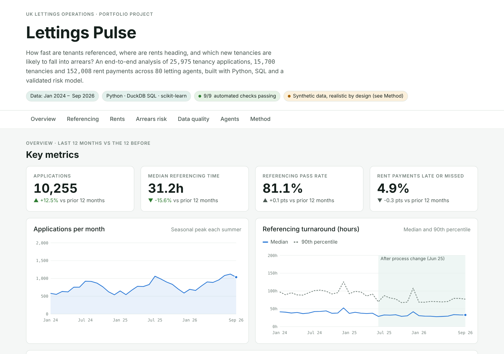
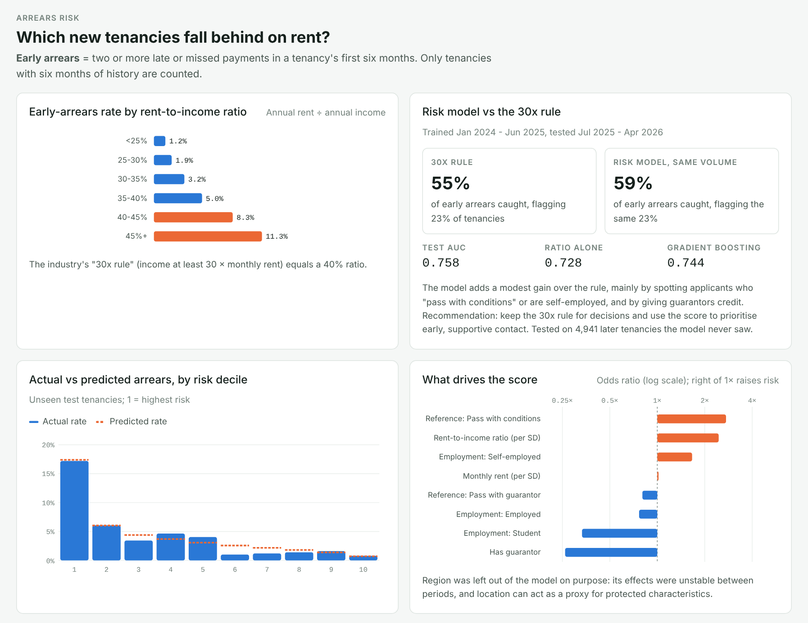
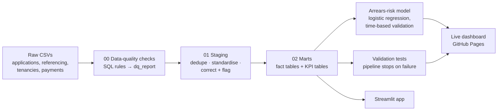
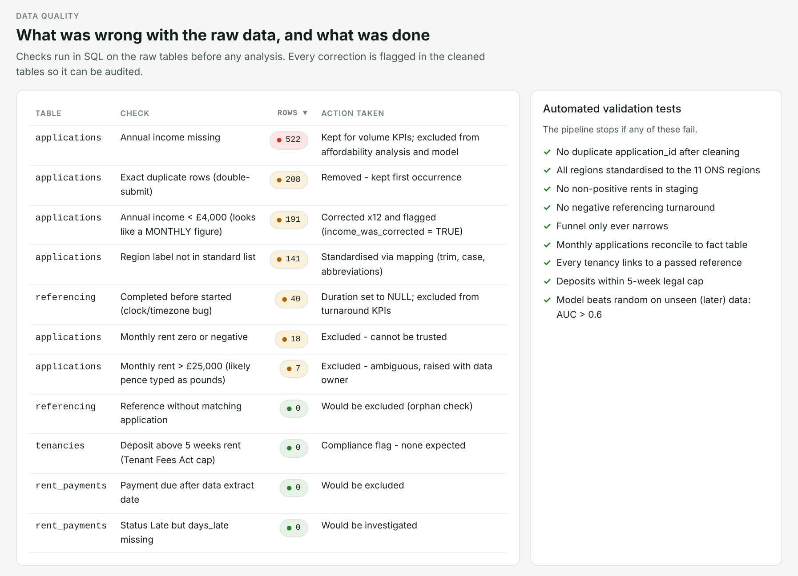

<div align="center">

# Lettings Pulse

### UK lettings operations analytics: SQL pipeline, data-quality checks, arrears-risk model and live dashboard

[](https://hamad470.github.io/uk-lettings-analytics/)
[](https://github.com/hamad470/uk-lettings-analytics/actions/workflows/ci.yml)


**[▶ Open the live dashboard](https://hamad470.github.io/uk-lettings-analytics/)**

</div>



## Overview

**Lettings Pulse** is an end-to-end data analytics project modelled on the day-to-day questions of a
UK lettings platform, the business that connects letting agents, tenants and landlords and handles
tenant referencing, tenancy agreements and rent collection.

Raw operational data (applications, referencing checks, tenancies and rent payments) runs through
**SQL data-quality checks**, a **cleaned staging layer** and **reusable analysis tables**. From there it
feeds an **interpretable arrears-risk model** and a **live dashboard** that an operations team or a
letting agent could use to monitor performance each week.

| Scale | |
|---|---|
| Rows of raw data | **220,000+** |
| Tenancy applications | **25,975** (after cleaning) |
| Tenancies / rent payments | **15,700 / 152,008** |
| Letting agents | **80** across 11 UK regions |
| Data-quality rules | **11**: 1,100+ problem rows found and handled |
| Automated validation tests | **9** in the pipeline, plus a pytest suite in CI |

---

## Business questions

1. **Referencing speed:** how long does tenant referencing take, and what slows it down?
   Slow referencing loses tenants and frustrates agents.
2. **Conversion:** where do applications drop out between submission and a signed tenancy?
3. **Rents:** how are rents on new tenancies changing in each region?
4. **Arrears risk:** can new tenancies likely to fall behind on rent be identified **better than the
   industry's "30x rent" affordability rule**, so agents can offer support early?
5. **Trust:** can these numbers be relied on? What is wrong with the raw data, and how was it handled?

## Key findings

| Finding | So what |
|---|---|
| Median referencing time fell **39h → 31h (−22%)** after a June 2025 process change | The change worked and should be kept |
| Referencing runs **34% slower every December** | Plan extra capacity, or set expectations with agents before Christmas |
| **Self-employed applicants take 57% longer** (49h vs 31h) | Income evidence is the bottleneck: a candidate for open-banking income checks |
| Late and missed rent payments **spike every January** | Proactive reminders after Christmas |
| Early-arrears rate climbs from **1.2%** (rent < 25% of income) to **11.3%** (45%+) | Affordability is the strongest single driver |
| The highest-risk 10% of new tenancies go into arrears at **4.1× the average rate** | The score usefully ranks risk |
| At the same flag volume (23% of tenancies) the model catches **59% of early arrears vs 55%** for the 30x rule | A modest, honest gain: keep the rule for decisions, use the score to prioritise early contact |



---

## How it works



### 1. Data-quality checks (`sql/00_data_quality_checks.sql`)

Rules run on the **raw** tables before any analysis. Each one logs how many rows failed and what was done:

| Issue found | Rows | Action |
|---|---:|---|
| Duplicate applications (double-submit bug) | 208 | Removed, first occurrence kept |
| Missing income | 522 | Kept for volume KPIs; excluded from affordability analysis and model |
| Monthly income typed into the annual field | 191 | Corrected ×12 and flagged (`income_was_corrected`) |
| Zero or negative rents | 18 | Excluded |
| Rents above £25,000/month (pence typed as pounds) | 7 | Excluded and raised with the data owner |
| Non-standard region names (`london `, `N. West`, `YORKSHIRE`) | 141 | Standardised to the 11 ONS regions |
| Referencing completed *before* it started (clock bug) | 40 | Duration set to NULL; excluded from turnaround KPIs |
| Deposits above the 5-week legal cap (Tenant Fees Act 2019) | 0 | Compliance check: none found |



### 2. Staging and marts (`sql/01_staging.sql`, `sql/02_marts.sql`)

All cleaning and metric logic is plain SQL, so it is easy to review and portable to BigQuery,
Snowflake or Postgres. Every correction is flagged rather than silently applied.

| Table | Grain | Used for |
|---|---|---|
| `fct_application` | one row per application | funnel, conversion, turnaround |
| `fct_tenancy` | one row per tenancy, with the early-arrears label | arrears analysis and model |
| `mart_monthly_kpis` | one row per month | trend charts and headline tiles |
| `mart_funnel` | one row per funnel stage | conversion funnel |
| `mart_region_rent`, `mart_region_rent_quarterly` | region / region × quarter | rent trends |
| `mart_segment` | employment type | referencing speed and pass rates |
| `mart_affordability` | rent-to-income band | arrears by affordability |
| `mart_agency` | letting agent | agent league table |

### 3. Validation tests (`src/pipeline.py → validate`)

The pipeline **stops** if any of these fail:

- No duplicate application IDs after cleaning
- Exactly 11 standard regions
- No non-positive rents; no negative referencing times
- Funnel only ever narrows
- Monthly totals reconcile to the fact table
- Every tenancy links to a passed reference
- All deposits within the 5-week legal cap
- Model beats random on unseen, later data

GitHub Actions rebuilds the whole pipeline and runs the tests on every push (see the badge above).

### 4. Arrears-risk model

- **Target:** *early arrears*, meaning two or more late or missed payments in a tenancy's first six months.
  Only tenancies with six months of history are labelled.
- **Model:** logistic regression, chosen because the odds ratios can be explained to non-technical
  colleagues and agents.
- **Time-based split:** trained on tenancies starting Jan 2024 – Jun 2025, tested on Jul 2025 – Apr 2026.
  A random split would leak future behaviour into training.
- **Benchmarked against the business rule** at the same flag volume, not only on AUC (test AUC **0.758**).
- **Challenger:** a gradient-boosting model scored *lower* on the test period (0.744), so the simpler,
  explainable model was kept.
- **Fairness:** region was deliberately left out. Its effects were unstable between periods, and
  location can act as a proxy for protected characteristics.

### 5. Investigating unexpected results

Odd-looking results were investigated rather than reported at face value:

- **"Conversion collapsed in the latest month."** Not real: recent applications haven't had time to become
  tenancies (*right-censoring*). The dashboard explains this instead of reporting a drop.
- **"North East rents fell 11%."** Based on only 25 lets, so a small-sample median swings by chance. The
  dashboard flags every region with fewer than 100 lets.
- **"69% of students go into arrears."** An early run showed this. Tracing it found the data simulator was
  ignoring guarantors; after the fix, having a guarantor became one of the model's strongest protective factors.

---

## About the data

Real tenant referencing and rent-payment data is personal and confidential, so it can't be published.
`src/generate_data.py` simulates a lettings platform instead, with a **fixed random seed** so every
number here is reproducible:

- Regional rent levels are loosely calibrated to published **ONS private-rent averages**, with growth slowing over time
- Seasonal demand (summer peak, December dip), and slower referencing for self-employed applicants and in December
- Arrears risk driven by affordability, employment type, reference outcome and guarantors, plus unobserved noise
- **Real-world data problems planted on purpose**, so the pipeline has to find and handle them

The structure and the techniques (SQL quality checks, staging, marts, validation, time-based model
evaluation) transfer directly to real production data.

## Use of AI

An AI assistant helped scaffold code and draft documentation. Its output was treated as a first draft
and checked:

- SQL results were reconciled against independent pandas calculations
- Model metrics were re-derived and compared against the business rule
- Simulated behaviour was checked against expectations, which is how the student/guarantor bug was caught

The analytical judgement calls were made by hand: the arrears definition, the time-based split, leaving
region out of the model, flagging small samples and right-censoring. No confidential data was used.

## What I would do next

- Replace the simulated rent view with the real **ONS Price Index of Private Rents**
- Add confidence intervals to small-sample medians
- Monitor model calibration monthly and retrain when it drifts
- Run an experiment to test whether faster referencing increases conversion

---

## Run it locally

```bash
git clone https://github.com/hamad470/uk-lettings-analytics.git
cd uk-lettings-analytics
pip install -r requirements.txt

python src/generate_data.py      # optional: raw data is already included in data/raw
python src/pipeline.py           # quality checks → staging → marts → model → validation
python src/build_dashboard.py    # builds docs/index.html (the live dashboard)
pytest -q                        # full rebuild plus tests
streamlit run app.py             # interactive Streamlit version
```

Or use the Makefile: `make all`, `make test`, `make app`.

## Project structure

```
uk-lettings-analytics/
├── sql/
│   ├── 00_data_quality_checks.sql   rules on raw data → dq_report
│   ├── 01_staging.sql               dedupe, standardise, correct + flag
│   └── 02_marts.sql                 fact tables and KPI marts
├── src/
│   ├── generate_data.py             reproducible synthetic lettings data
│   ├── pipeline.py                  orchestration, model, validation, exports
│   └── build_dashboard.py           injects results into the dashboard
├── dashboard/template.html          dashboard source (HTML/CSS/SVG, no dependencies)
├── docs/
│   ├── index.html                   built dashboard, served by GitHub Pages
│   └── assets/                      screenshots
├── app.py                           Streamlit version of the dashboard
├── data/
│   ├── raw/                         raw CSVs (with planted quality issues)
│   └── processed/                   marts (Parquet) and model results
├── tests/test_pipeline.py           pytest suite, run in CI
└── .github/workflows/ci.yml         GitHub Actions: build and test on every push
```

## Author

**Hamad Ur Rehman**
GitHub: [@hamad470](https://github.com/hamad470)

Feedback and questions are welcome. Please open an issue.

## License

Released under the [MIT License](LICENSE).
